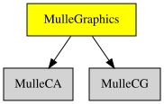

# 🌠 MulleGraphics

#### 🌠 MulleGraphics provides CALayer subclasses

This library ties MulleCA and MulleCG together. It adds the drawing
functionality to **CALayer** and adds several useful subclasses for drawing
images and text.

It's not nanovg agnostic (yet) as the layers use nanovg for drawing.

To create your own drawings, it's easiest to use a CALayer and do a
`-setDrawCallback:` to your C drawing code function. If you need to keep state
between frames, subclass CALayer and override the `-drawInContext:` method.


### CALayer Subclasses

Class             | Description
------------------|-----------------------------------------
`CACPUImageLayer` | A bitmap drawn by the CPU.
`CAGradientLayer` | A gradient drawing layer
`CAImageLayer`    | A layer that draws a vector image or a bitmap image
`CAOpenGLLayer`   | A layer to draw with OpenGL graphic commands.
`CAShapeLayer`    | A layer for simple drawings with nanovg
`CATextLayer`     | A layer for rendering short texts


There is no event handling.
There is no window setup.
There is no image file writing

Based on MulleObjC. The MulleFoundation (e.g. NSString, or NSArray) is not yet
available.


### You are here




## Add

Use [mulle-sde](//github.com/mulle-sde) to add MulleGraphics to your project:

``` console
mulle-sde dependency add --c --github <|GITHUB_USER|> MulleGraphics
```

## Install

### mulle-sde

Use [mulle-sde](//github.com/mulle-sde) to build and install MulleGraphics
and all its dependencies:

```
mulle-sde install --prefix /usr/local \
   https://github.com/<|GITHUB_USER|>/MulleGraphics/archive/latest.tar.gz
```

### Manual Installation


Install the requirements:

Requirements                                      | Description
--------------------------------------------------|-----------------------
[some-requirement](//github.com/some/requirement) | Some requirement

Install into `/usr/local`:

``` sh
cmake -B build \
      -DCMAKE_INSTALL_PREFIX=/usr/local \
      -DCMAKE_PREFIX_PATH=/usr/local \
      -DCMAKE_BUILD_TYPE=Release &&
cmake --build build --config Release &&
cmake --install build --config Release
```

### Steal

Read [STEAL.md](//github.com/mulle-c11/dox/STEAL.md) on how to steal the
source code and incorporate it in your own projects.
