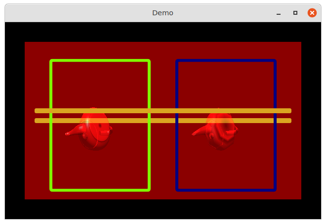
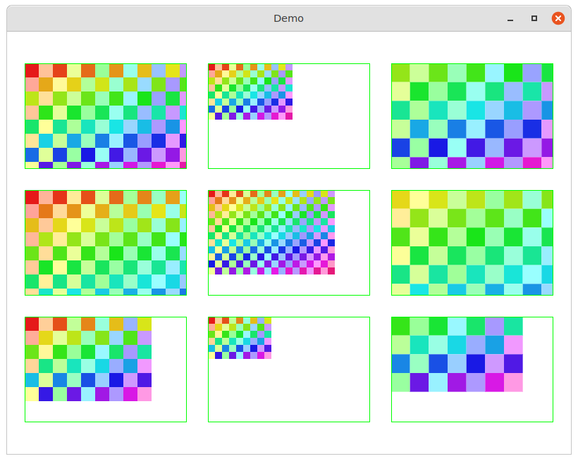
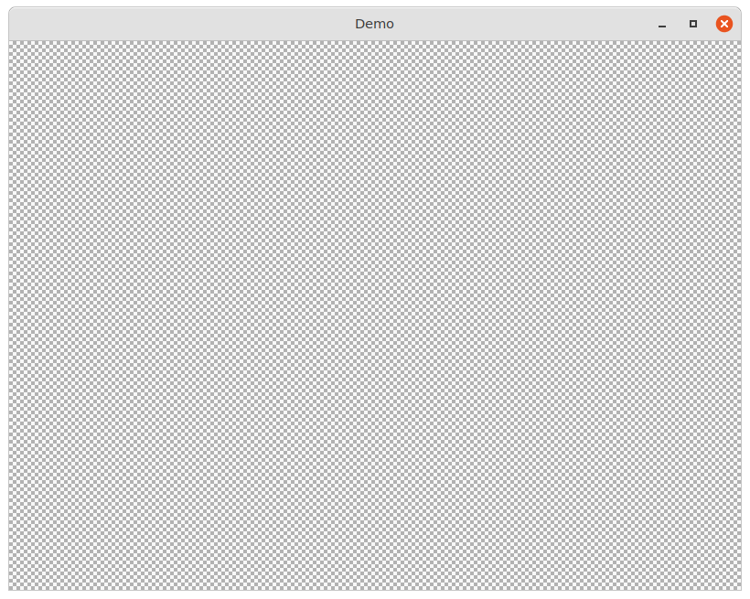
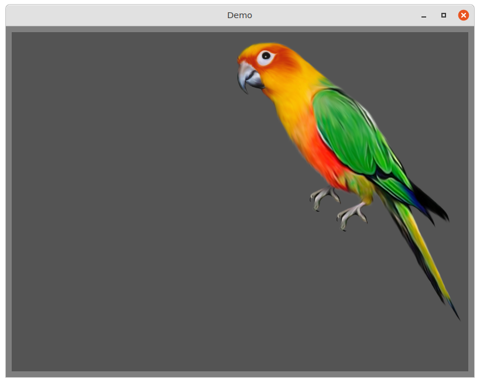
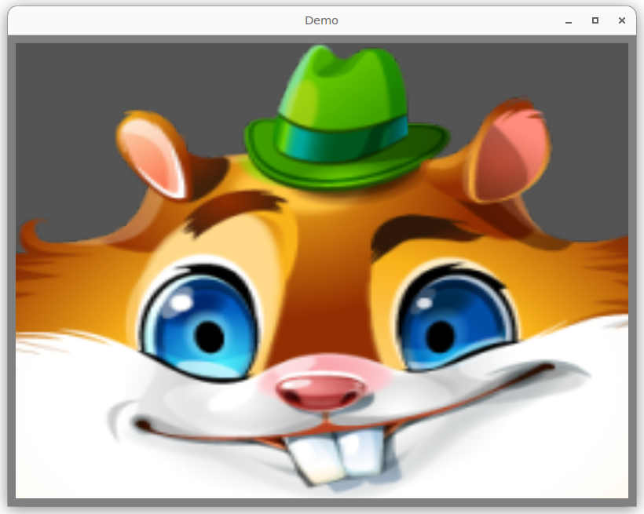

# demos

#### 💥 demos of MulleGraphics

The demos actually require MulleUICore to run. It's too tedious to set
everything up again for linking with glfw and X11, and basically that's what
MulleUICore is there for anyway.


## opengl-mix

Mix (old) OpenGL code with modern nanovg based UIViews using the
CAOpenGLLayer.




## canvas-bounds-frame

Shows the differences between a CALayer canvas, bounds, frame properties



## checkerboard

Create a GPU texture from static bytes and display it.




## glsl-shader

Demo of a CAOpenGLLayer with a custom shader.


## image

Demo of GPU texture being loaded from disk. With various settings for
`contentMode` a simple kind of animation is done




## image-part

How to only display a part of a texture.




## opengllayer

Demo of `CAOpenGLLayer`. In this demo the convenience function
`windowWithLayer:titleUTF8String:`, will detect that `CAOpenGLLayer` prefers
`UIWindowOpenGLDeprecated` through the `-windowStyleMaskBits` method and
will try to create a compatible window. The drawin of the triangle is the
default implementation of `CAOpenGLLayer`:


## Build

This is a [mulle-sde](https://mulle-sde.github.io/) project.

It comes with its own virtual environment and list of dependencies.
To fetch and build everything say:

```
mulle-sde craft --release
```
